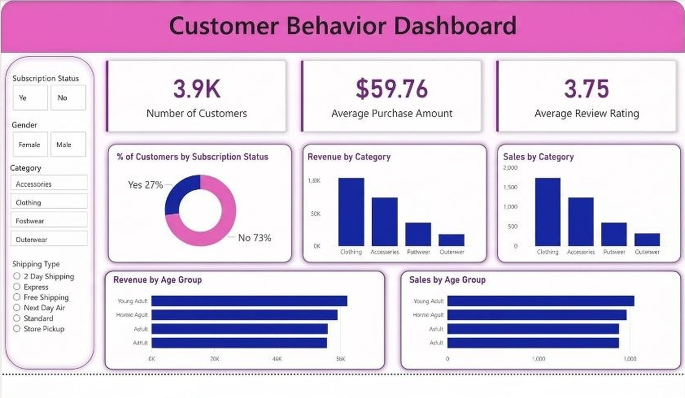

# Customer Shopping Behavior Analysis

End-to-end analysis of 3,900 retail purchases: data cleaning in **Python**, business questions answered in **PostgreSQL**, and an interactive **Power BI** dashboard, with a summary deck for stakeholders.



## Business Problem

A retail business wants to understand who its customers are and what drives spend: which segments bring in the most revenue, whether discounts, shipping options and subscriptions change buying behaviour, and where to focus marketing and loyalty efforts.

## Tech Stack

| Stage | Tools |
|---|---|
| Cleaning and feature engineering | Python (pandas), Jupyter |
| Database and analysis | PostgreSQL (SQLAlchemy / psycopg2 to load data) |
| Visualisation | Power BI |
| Reporting | PowerPoint |

## Repository Contents

| File | Description |
|---|---|
| `customer_shopping_behavior.csv` | Raw dataset (3,900 rows, 18 columns) |
| `customer_shopping_behavior_analysis.ipynb` | Python notebook: cleaning, feature engineering, load to SQL |
| `customer_behavior_sql_queries.sql` | 10 business questions answered in PostgreSQL |
| `customer_behavior_dashboard.pbix` | Power BI dashboard |
| `Customer-Shopping-Behavior-Analysis.pptx` | Summary presentation |
| `dashboard.png` | Dashboard screenshot |
| `requirements.txt` | Python dependencies |

## Dataset

3,900 transactions, one row per customer purchase. Columns include customer demographics (age, gender, location), product details (item, category, size, color, season), purchase details (amount in USD, discount applied, promo code, shipping type, payment method) and behaviour (review rating, subscription status, previous purchases, purchase frequency).

Only `Review Rating` had missing values (37 rows).

## Data Preparation (Python)

1. Loaded the CSV with pandas and checked structure, types and summary statistics.
2. Imputed the 37 missing `Review Rating` values with the **median rating of the product category**.
3. Standardised column names to snake_case (`Purchase Amount (USD)` → `purchase_amount`).
4. Created `age_group` using quartile binning (`pd.qcut`): Young Adult (18–31), Adult (32–44), Middle-aged (45–57), Senior (58–70).
5. Created `purchase_frequency_days` by mapping frequency labels (Weekly = 7, Fortnightly = 14, Monthly = 30, and so on).
6. Dropped `promo_code_used` after confirming it is identical to `discount_applied`.
7. Loaded the cleaned table into PostgreSQL with SQLAlchemy.

## SQL Analysis

All queries are in [`customer_behavior_sql_queries.sql`](customer_behavior_sql_queries.sql). They use aggregations, subqueries, CTEs, `CASE` logic and window functions (`ROW_NUMBER`).

| # | Question |
|---|---|
| 1 | Total revenue by gender |
| 2 | Customers who used a discount but spent above the average purchase amount |
| 3 | Top 5 products by average review rating |
| 4 | Average purchase amount: Standard vs Express shipping |
| 5 | Do subscribers spend more? (customers, average spend, total revenue) |
| 6 | Top 5 products by share of purchases with a discount |
| 7 | Customer segments: New, Returning, Loyal |
| 8 | Top 3 most purchased products in each category |
| 9 | Are repeat buyers (more than 5 previous purchases) more likely to subscribe? |
| 10 | Revenue contribution by age group |

## Key Findings

Headline numbers: **3,900 purchases, $233,081 total revenue, $59.76 average purchase, 3.75 average rating.**

- **Gender:** Male customers generate about 68% of revenue ($157,890 vs $75,191), largely because they make up 68% of purchases (2,652 vs 1,248). Average spend per purchase is almost identical ($59.54 male, $60.25 female).
- **Category:** Clothing is the biggest revenue driver ($104,264, 45%), followed by Accessories ($74,200, 32%), Footwear ($36,093, 15%) and Outerwear ($18,524, 8%).
- **Age:** Revenue is spread fairly evenly across the four age groups; Young Adults (18–31) lead at $62,143.
- **Top-rated products:** Gloves (3.86), Sandals (3.84), Boots (3.82), Hat (3.80), Handbag (3.78). The spread is narrow, so ratings are fairly uniform across products.
- **Discounts:** 839 customers used a discount and still spent at or above the average purchase amount. Hat (50.0%), Sneakers (49.7%), Coat (49.1%), Sweater (48.2%) and Pants (47.4%) have the highest discount rates.
- **Shipping:** Express averages $60.48 vs $58.46 for Standard (about 3% higher). Differences across all six shipping types are small ($58.46 to $60.73).
- **Subscriptions:** 27% of customers (1,053) subscribe. Subscribers' average spend ($59.49) is essentially the same as non-subscribers' ($59.87), and subscribers make up about 27% of revenue, in line with their share of customers. Among repeat buyers (more than 5 previous purchases), 27.5% subscribe, so there is no sign that repeat buyers are more likely to subscribe.
- **Segments (by previous purchases):** Loyal (more than 10) 79.9%, Returning (2–10) 18.0%, New (1) 2.1%. The base is heavily weighted to established customers.

### Recommendations

- Subscriptions don't currently lift spend per purchase; revisit subscriber benefits before investing in promotion.
- With roughly 80% of customers already Loyal, focus on retention and reward programmes, and test acquisition channels to grow the small New segment.
- Women spend as much per purchase as men but make far fewer purchases; test campaigns to raise female purchase frequency.
- Use the top-rated products (Gloves, Sandals, Boots) in campaigns, and review discount depth on products already discounted about half the time (Hat, Sneakers, Coat).

## Power BI Dashboard

File: [`customer_behavior_dashboard.pbix`](customer_behavior_dashboard.pbix) (open with Power BI Desktop).

- **KPI cards:** Number of Customers, Average Purchase Amount, Average Review Rating
- **Charts:** Revenue and sales by Category, Revenue and sales by Age Group, % of customers by Subscription Status (donut)
- **Slicers:** Subscription Status, Gender, Category, Shipping Type

## How to Run

```bash
git clone https://github.com/divyanshup0907/dashboards.git
cd dashboards
pip install -r requirements.txt
```

1. Create a PostgreSQL database named `customer_behavior`.
2. Set your database password as an environment variable (never hard-code it):
   ```bash
   export DB_PASSWORD="your_password"        # Windows PowerShell: $env:DB_PASSWORD="your_password"
   ```
3. Run `customer_shopping_behavior_analysis.ipynb` (keep the CSV in the same folder). It cleans the data and creates the `customer` table.
4. Run the queries in `customer_behavior_sql_queries.sql` in pgAdmin or psql.
5. Open the `.pbix` file in Power BI Desktop.

The notebook also includes connection snippets for MySQL and SQL Server.

## Author

**Divyanshu Pandey**, aspiring Data / BI Analyst
*** Guidance by—-Amlan Mohanty

[LinkedIn](https://github.com/divyanshup0907/dashboards) · [Email](divyanshu090794@gmail.com)
